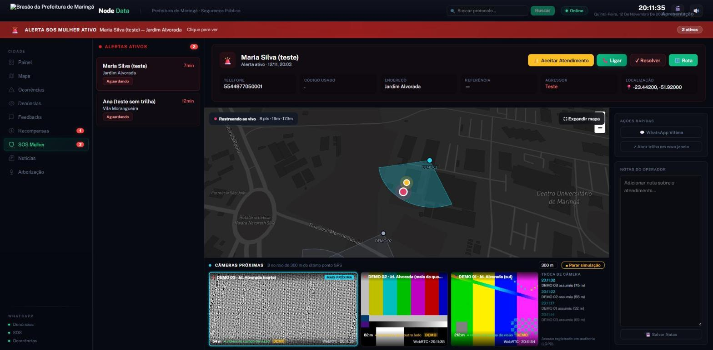

# Câmeras ao vivo no SOS Mulher

**Pesquisa, arquitetura e plano de integração · Maringá-PR · novembro de 2026**
Node Data

> Convenção deste documento: **[FATO]** tem fonte (link na seção 10) ou foi medido por nós no protótipo. **[SUPOSIÇÃO]** é estimativa ou inferência nossa e precisa ser confirmada com a Prefeitura, com o fornecedor ou com o jurídico.



*Protótipo rodando localmente. As câmeras "DEMO" não existem: o vídeo é um sinal de teste sintético.*

---

## 1. Resumo executivo (para quem não é técnico)

**A ideia.** Hoje, quando uma mulher dispara o SOS pelo WhatsApp, o operador vê no mapa onde ela está e para onde está andando, ponto a ponto. Com esta integração ele passa a ver também **as câmeras da cidade mais próximas dela, ao vivo, na mesma tela**. Se ela anda, o painel troca sozinho para a câmera da próxima quadra. O operador acompanha o deslocamento rua a rua, enxerga se o agressor está junto, em que carro, em que direção, e passa isso para a viatura antes de ela chegar.

**Por que isso é viável em Maringá agora.**
1. **A cidade já tem as câmeras.** O Centro de Controle Integrado (CCI) da Guarda Civil Municipal funciona desde 2023 com câmeras, reconhecimento facial e leitura de placas em 44 pontos. Em 2025 a GCM passou a acessar cerca de 1.800 câmeras de escolas e Cmeis. **[FATO]**
2. **O Estado está colocando mais câmeras.** O programa Olho Vivo (Sesp-PR) chegou a Maringá em 2026, guarda imagens por 90 dias e prevê, em fases futuras, monitorar agressores de mulheres. Existe minuta padrão de Termo de Cooperação da PGE-PR para municípios com guarda municipal. **[FATO]**
3. **A Patrulha Maria da Penha de Maringá é referência.** São 9 anos de atuação, cerca de 1,2 mil mulheres acompanhadas, tempo médio de resposta de 5 minutos e prêmio internacional em 2026. **[FATO]** O que falta é juntar, na mesma tela, o pedido de socorro, a posição GPS e a imagem.
4. **A tecnologia para juntar é aberta e barata.** O "tradutor" entre a câmera e o navegador (MediaMTX) é software livre (licença MIT). Com ele a imagem chega ao painel em menos de um segundo. **[FATO]** Nosso protótipo já faz isso.

**O que muda para a vítima.** O tempo entre o pedido de socorro e a viatura saber *exatamente* o que está acontecendo cai de "ligar, perguntar, esperar" para "olhar". **[SUPOSIÇÃO]:** não medimos ainda o ganho em minutos; só um piloto com a GCM vai dizer.

**O que NÃO fazemos (limite ético inegociável).** Só usamos câmeras **autorizadas**: próprias da Prefeitura, de convênio formal (Estado) ou de parceiros que aderiram por escrito. Não varremos a internet atrás de câmeras abertas e não usamos senha padrão de equipamento. A câmera só abre durante um SOS ativo, e cada abertura fica registrada (quem viu, qual câmera, em qual alerta, quando).

**O que precisamos da Prefeitura para sair do protótipo:** (1) acesso de teste a 2 ou 3 câmeras do CCI; (2) uma conversa com o integrador do CCI sobre o software de vídeo (VMS) usado lá; (3) o instrumento jurídico interno (portaria/termo) autorizando o uso no SOS Mulher, mais um Relatório de Impacto (RIPD).

---

## 2. O que existe em Maringá e no Paraná

| Rede | Quem opera | O que se sabe | Fonte |
|---|---|---|---|
| **CCI (Centro de Controle Integrado)** | Guarda Civil Municipal | Inaugurado em fev/2023. 10 baias, 140 câmeras, 24h, concentra o 153. Software **ISS SecurOS** (FaceX para rosto, SecurOS Auto para placas, 80 licenças). Big Data "Smart Eye" integrado a PM, PC, Bombeiros, Educação e Assistência Social. LPR em **44 pontos**. | [FATO] [1] |
| Implantação do CCI | Integradoras ALCA NETWORK e ALLNET | Câmeras **VIVOTEK**, com reconhecimento facial e de placas. Implantação a partir de jul/2022. | [FATO] [2] |
| **Câmeras de escolas e Cmeis** | Educação, com acesso da GCM | Cerca de 1.800 câmeras com imagens acessíveis à GCM desde mai/2025. | [FATO, trecho de busca] [3] |
| **Despacho** | GCM | CAD 3.0 do Sinesp desde out/2025, com localização de quem liga no 153. | [FATO, trecho de busca] [4] |
| **Olho Vivo (estadual)** | Sesp/Secid/SGSD, plataforma com Google | Lançado em 10/12/2025. Meta de 26,5 mil câmeras, 20 mil compradas pelos municípios com repasse estadual. Adesão voluntária. LPR e reconhecimento facial. **Retenção de 90 dias**, prorrogável. Prevê monitorar agressores de mulheres em fases futuras. | [FATO] [5] |
| Olho Vivo em Maringá | Município + Estado | Em 12/02/2026, Maringá estava entre os 22 municípios do programa, "próxima de 100%" das câmeras previstas na fase. Número absoluto não divulgado. | [FATO] [6] |
| Acesso das guardas ao Olho Vivo | Estado | Anúncio de 10/12/2025: guardas municipais terão acesso às imagens do Olho Vivo, ao 181 e a bases de veículos, pessoas e mandados. | [FATO] [7] |
| **Termo de Cooperação Olho Vivo** | PGE-PR | Minuta padrão "Municípios com Guarda Municipal". Pelo trecho, o acesso passa pela rede do Estado com apoio da Celepar e o compartilhamento é preferencialmente por API. | [FATO, arquivo não aberto] [8] |
| **Patrulha Maria da Penha** | GCM | Desde 2017. Em set/2026: cerca de 1,2 mil mulheres acompanhadas, mais de 18,7 mil atendimentos, tempo médio de resposta de 5 min. Prêmio IACP em out/2026. | [FATO, release reproduzido] [9][10] |
| **Botão do Pânico Virtual** | PM-PR (app 190 PR) | Só para quem tem medida protetiva e autorização judicial. Envia GPS e grava 1 min de áudio. Cai no Copom da PM, não na GCM. | [FATO] [11] |

**Esclarecimento de nomes.** "Muralha Digital" é programa **municipal de Curitiba**; "Muralha Paulista" é de São Paulo. O equivalente estadual no Paraná é o **Olho Vivo**. **[FATO]** [5][12]

**Não encontramos (perguntar à Prefeitura):** contrato e número atual de câmeras do CCI; se o SecurOS instalado expõe API ou re-stream RTSP; prazo de retenção usado pelo CCI; central de câmeras de trânsito da Semob; programa municipal de "câmera parceira" privada; endereço e data da Casa da Mulher Brasileira de Maringá (há menção, não confirmada).

**Precedentes úteis para a conversa com a Prefeitura:**
- **Curitiba:** o botão do pânico concedido pela Justiça "ativa um alerta para a Muralha Digital" e para a Patrulha Maria da Penha, que vê localização e áudio da vítima. É o mais parecido com a nossa proposta. **[FATO, trecho de busca]** [13]
- **Curitiba, Conecta Muralha:** câmeras privadas integradas por Decreto 1.520/2025 (regulamenta a Lei Municipal 15.405/2019), com licença e Termo de Responsabilidade. 300 câmeras de empresas em fev/2026. É o modelo jurídico para "câmera parceira". **[FATO]** [14]
- **São Paulo:** convênio Prefeitura + MP-SP (25/08/2026) para usar o Smart Sampa (mais de 50 mil câmeras) na localização de agressores. **[FATO]** [15]
- **Paraná, Antonina (jan/2026):** suspeito de violência doméstica localizado pelas câmeras do Olho Vivo a partir da placa do carro. **[FATO]** [16]
- **Alerta:** em dez/2025, instituições apontaram que o Muralha Paulista viola a LGPD. Projetos parecidos carregam esse risco de reputação, e o desenho jurídico precisa vir antes da tecnologia. **[FATO]** [17]

---

## 3. Arquitetura recomendada

### 3.1 Princípio: o vídeo não sai da rede da Prefeitura sem necessidade

O painel (este sistema) roda numa VPS fora da Prefeitura. As câmeras estão na rede do CCI. A recomendação é colocar um **gateway de vídeo (MediaMTX) dentro da rede da Prefeitura**, ao lado do VMS do CCI. O operador, que também está no CCI, recebe o vídeo direto desse gateway. A VPS guarda só o **cadastro** das câmeras (posição, direção, nome do caminho) e **autoriza** cada abertura. A imagem em si nunca passa pela nuvem. **[SUPOSIÇÃO de desenho]:** depende de a rede do CCI permitir esse servidor; validar com a TI.

O protótipo já suporta isso: os prefixos de vídeo devolvidos pela API são configuráveis (`CAMERAS_WEBRTC_PREFIX` e `CAMERAS_HLS_PREFIX`), então podem apontar para o gateway local em vez do nginx da VPS.

```
                      REDE DA PREFEITURA (CCI)                          |        NUVEM (VPS Node Data)
                                                                        |
  [Câmeras GCM]  [Escolas]  [Olho Vivo*]  [Parceiras**]                 |
        \            |           |             /                        |
         \  RTSP/ONVIF (substream 640x360, só sob demanda)              |
          v          v           v            v                         |
     +-----------------------------------------+                        |
     | VMS do CCI (ISS SecurOS)  (grava, PTZ)  |  <- fonte oficial      |
     +-----------------------------------------+     e guarda as        |
                       | re-stream RTSP              gravações          |
                       v                                                |
     +-----------------------------------------+   pergunta "pode?"   +------------------------+
     | Gateway MediaMTX (on-prem)              | -------------------> | Backend FastAPI        |
     | RTSP -> WebRTC (<1 s) / HLS (2 a 4 s)   |   (auth HTTP, token  |  /api/cameras/proximas |
     +-----------------------------------------+    do operador)      |  /internal/mediamtx/   |
                       | WebRTC/HLS                                   |      auth              |
                       v                                              |  audit_log (LGPD)      |
     +-----------------------------------------+   lista câmeras      +------------------------+
     | Navegador do operador (painel SOS)      | <------------------- | Supabase: cameras,     |
     |  mapa + trilha GPS + "Câmeras próximas" |   e trilha GPS       |  sos_alertas,          |
     +-----------------------------------------+   (Realtime)         |  emergencia_pontos     |
                                                                      +------------------------+
                                                                                  ^
                              Vítima (WhatsApp + link GPS) -----------------------+

  *  Olho Vivo: via Termo de Cooperação com a Sesp-PR (API/Celepar), formato a confirmar.
  ** Parceiras: só com termo de adesão (modelo Conecta Muralha de Curitiba).
```

### 3.2 Como funciona, passo a passo

1. A vítima manda "." no WhatsApp. O sistema cria o alerta e manda o link de rastreamento. O GPS entra em `emergencia_pontos` a cada poucos segundos (já existe).
2. O painel pega o **último ponto GPS** e chama `GET /api/cameras/proximas?lat=&lng=&raio=300&alerta_id=`.
3. O backend busca na tabela `cameras` as câmeras ativas dentro de uma "caixa" em volta do ponto (índice em lat/lng) e calcula para cada uma:
   - distância exata (haversine);
   - se a vítima está **dentro do cone de visão** (rumo câmera→vítima comparado com `direcao_graus` ± `campo_visao_graus`/2);
   - uma nota de prioridade: câmera apontada para a vítima e dentro do alcance vale mais que outra um pouco mais perto, mas de costas.
4. O painel mostra as 4 melhores. A primeira ("MAIS PRÓXIMA") fica maior e destacada no mapa com o cone de visão.
5. Quando a vítima anda 20 m (ou a cada 15 s), o painel refaz a busca. Câmeras que continuam no ranking **não reiniciam o vídeo**; as novas entram, as que saíram do raio fecham. A troca da principal aparece num pequeno histórico ("14:32:10 DEMO 02 assumiu, 55 m").
6. O vídeo toca por **WebRTC (WHEP)**. Se em 6 s não chegar quadro (UDP bloqueado, por exemplo), cai sozinho para **HLS** por hls.js. **[FATO, testado no protótipo]**
7. Cada abertura e fechamento de vídeo grava no `audit_log`: operador, câmera, alerta, distância, IP, horário.
8. O MediaMTX, antes de entregar qualquer vídeo, pergunta ao backend se o token do operador é válido (`authMethod: http`). Sem login, sem imagem. **[FATO, testado: sem token responde 401]**

### 3.3 Por que não usar o VMS do CCI direto no navegador?

Pode ser o caminho, se o SecurOS tiver um cliente web embutível com API. **[SUPOSIÇÃO]:** não confirmamos o que a versão instalada oferece; perguntar ao integrador (ALCA/ALLNET) e à ISS. Mesmo assim, o gateway MediaMTX tem vantagens: independe de fornecedor, entrega WebRTC sub-segundo em qualquer navegador e deixa a autorização amarrada ao alerta SOS no nosso backend.

---

## 4. Comparação das ferramentas open source

### 4.1 Servidor de mídia (RTSP/ONVIF para o navegador)

| Ferramenta | Licença | Para o navegador | Pontos fortes | Pontos fracos | Veredito |
|---|---|---|---|---|---|
| **MediaMTX** | MIT [FATO] | WebRTC (WHEP), LL-HLS | Binário único, Docker oficial, autenticação interna/HTTP/JWT [FATO], API de controle para cadastrar câmera sem reiniciar, `sourceOnDemand` (só puxa a câmera quando alguém assiste). Só remuxa, não transcodifica. | Sem interface de VMS (não é gravador completo); WebRTC atrás de NAT pede porta UDP/TCP 8189 ou TURN [FATO] | **Escolhido para o protótipo** |
| **go2rtc** | MIT [FATO] | WebRTC, MSE, HLS, MJPEG | Latência mínima, ONVIF como entrada e saída, muitos protocolos proprietários, usado por Frigate e Home Assistant [FATO]. Transcodifica com FFmpeg quando precisa. | Autenticação fraca: o próprio projeto recomenda proxy reverso para proteger a interface [FATO]. Mais voltado a casa/pequeno porte. | Ótimo par do Frigate (fase IA) |
| **Janus** | GPL-3 [SUPOSIÇÃO: conferir] | WebRTC | Muito flexível (plugins), escala bem | Complexo de operar; RTSP via plugin de streaming; GPL | Exagero para o caso |
| **SRS** | MIT [SUPOSIÇÃO: conferir] | WebRTC, HLS, HTTP-FLV | Forte em transmissão ao vivo de alto volume | Focado em RTMP/broadcast, não em câmera de segurança | Não recomendado |

Latência típica: WebRTC abaixo de 1 s; LL-HLS de 2 a 4 s; HLS comum de 6 a 15 s. O go2rtc classifica WebRTC como "best" e HLS como "bad" em latência [FATO]. **[SUPOSIÇÃO]:** os números em segundos são ordem de grandeza da prática, não medimos com relógio no protótipo.

**Consumo medido no protótipo [FATO]:** MediaMTX com **3 câmeras demo** tocando ao mesmo tempo usou cerca de **14% de CPU e 103 MB de RAM** num notebook com Docker Desktop. Atenção: quase todo esse CPU é o ffmpeg *gerando* o sinal de teste. Com câmera real o MediaMTX só reempacota (não codifica), e o custo cai para perto de zero por fluxo. **[SUPOSIÇÃO]:** um servidor modesto (4 a 8 núcleos) atende dezenas de fluxos simultâneos; o gargalo vira rede (cerca de 0,5 a 1 Mbit/s por substream 640x360).

### 4.2 VMS / NVR (gravação e gestão)

| Ferramenta | Licença | Comentário |
|---|---|---|
| **Frigate** | MIT (marca e logo à parte) [FATO] | NVR com detecção de objetos por IA em tempo real. Recomenda GPU ou acelerador de IA [FATO]. Usa go2rtc para ao vivo. Bom para a fase de IA em poucas câmeras. |
| **ZoneMinder** | GPL-2 [SUPOSIÇÃO: conferir] | Veterano, pesado, interface datada. Não agrega frente ao VMS que o CCI já tem. |
| **Shinobi** | Licença ambígua: CE sob GPL, Pro com EULA própria; uso comercial pode exigir licença paga [FATO, fontes divergentes] | Risco jurídico para contrato público. Não recomendado. |
| **Agent DVR** | Proprietário, gratuito só para uso pessoal [SUPOSIÇÃO: conferir] | Fora por licença. |
| **ISS SecurOS** (já no CCI) | Comercial | É a fonte oficial em Maringá. A integração deve **consumir** dele, não substituí-lo. |

**Conclusão:** não precisamos de VMS novo. O CCI já grava e gerencia. Nosso papel é um **gateway leve (MediaMTX) + cadastro geográfico + regra de "quais câmeras mostrar agora"**.

### 4.3 ONVIF (descobrir câmeras, ler direção, girar PTZ)

- **Bibliotecas Python:** `onvif-zeep-async` (usada pela integração ONVIF do Home Assistant) e `onvif-zeep` (mais antiga, síncrona). Descoberta na rede por WS-Discovery (`WSDiscovery`). **[SUPOSIÇÃO: nomes conhecidos do ecossistema, conferir versão e manutenção antes de usar]**
- **Uso proposto:** (a) importar o inventário de câmeras que o CCI autorizar (perfil, substream RTSP); (b) **PTZ:** quando a câmera principal for PTZ, o painel pode pedir ao operador do CCI para girá-la, ou girar direto se o termo de cooperação permitir.
- **Fora de questão:** descoberta ONVIF em rede de terceiros ou teste de senha padrão.

---

## 5. Cadastro geográfico e "câmeras mais próximas"

### 5.1 Tabela `cameras` (migration 029, já no repositório)

| Campo | Para que serve |
|---|---|
| `lat`, `lng` | Posição da câmera |
| `direcao_graus`, `campo_visao_graus`, `alcance_m` | Cone de visão: se a vítima está "na frente" da câmera e a que distância ainda dá para reconhecer alguém |
| `tipo` | fixa, ptz, lpr, transito, parceira, demo |
| `url_stream` | Fonte interna (RTSP). **Nunca vai ao navegador.** Em produção, cifrar com AES-256-GCM (`crypto.py` já existe), porque carrega usuário e senha |
| `stream_path` | Nome do caminho no MediaMTX. É só isso que o navegador recebe |
| `orgao_responsavel`, `convenio_ref` | Quem opera e **qual instrumento jurídico autoriza** o uso. Câmera sem `convenio_ref` não deveria entrar como `ativo` |
| `ativo`, `demo` | Liga/desliga; marca demonstração |

RLS ligada, sem acesso para `anon` nem `authenticated`: só o backend lê, justamente para não vazar `url_stream`.

### 5.2 Consulta por raio

- **Hoje (protótipo):** pré-filtro por caixa com índice B-tree em `(lat, lng)` + haversine e cone em Python. Para centenas ou poucos milhares de câmeras é instantâneo.
- **Escala (Olho Vivo com milhares de câmeras na região):** migrar para PostGIS (`geography(Point)`, índice GiST, `ST_DWithin` + `ST_Distance`). O Supabase oferece a extensão. A troca fica isolada na função `_candidatas` do backend.

### 5.3 Troca automática conforme a trilha avança

Regras implementadas no protótipo:
- nova busca quando a vítima anda **20 m** ou a cada **15 s**;
- resposta antiga é descartada (sequência de requisições), e a troca de alerta zera tudo;
- vídeos que continuam no ranking **não reiniciam** (posição estável na tela; a "principal" só muda de tamanho e destaque);
- histórico curto das trocas para o operador narrar à viatura.

Melhorias previstas: **prever a próxima câmera** pelo rumo e velocidade da trilha (abrir antes de ela chegar); **histerese** (só trocar a principal se a nova for, por exemplo, 20% melhor) para evitar "pisca-pisca" entre duas câmeras equidistantes.

---

## 6. Bônus de IA (opcional, com honestidade sobre custo)

**O que daria para fazer:** marcar automaticamente, no trecho da vítima, "pessoa detectada", "pessoa correndo", "veículo parou ao lado". Com Frigate (MIT) + modelo YOLO, os eventos viram marcadores na linha do tempo do alerta. Com a LPR que o CCI já tem nos 44 pontos, cruzar a placa do veículo do agressor (se cadastrada com autorização judicial) com passagens próximas da vítima.

**Custo real [SUPOSIÇÃO, valores de mercado a cotar]:**
- Detecção em poucas câmeras (as 4 do alerta ativo, sob demanda): um acelerador tipo Google Coral USB ou Hailo-8L num mini PC dá conta. Ordem de grandeza: R$ 1.000 a R$ 3.000 de hardware.
- Detecção contínua em dezenas ou centenas de câmeras: GPU NVIDIA dedicada por grupo de câmeras. Ordem de dezenas de milhares de reais, mais energia e manutenção.
- O CCI **já tem** reconhecimento facial e LPR licenciados no SecurOS [FATO]. É mais barato e juridicamente mais limpo **consumir eventos do SecurOS** (se houver API) do que montar IA paralela.

**Recomendação:** não colocar IA na fase 1. Reconhecimento facial em particular tem o maior risco jurídico e reputacional (ver Muralha Paulista [17]). Se entrar, que seja detecção de "pessoa/veículo" sem identificação, só nas câmeras do alerta ativo.

---

## 7. Plano de integração por fases

| Fase | O que entrega | Pré-requisito | Prazo estimado [SUPOSIÇÃO] |
|---|---|---|---|
| **0. Protótipo (pronto)** | Painel "Câmeras próximas" com 6 câmeras demo, troca automática, cone no mapa, WebRTC com reserva HLS, auditoria, autorização do vídeo pelo login, limitação de finalidade opcional | Nenhum | Feito |
| **1. Piloto real, rápido** | 2 a 3 câmeras do CCI numa região de maior incidência (escolhida com a Patrulha Maria da Penha). MediaMTX on-prem no CCI puxando o substream. Cadastro manual com direção e alcance medidos em campo. `CAMERAS_EXIGIR_ALERTA=true`. Treino de 2 operadores. | Portaria/ato da Secretaria de Segurança autorizando o uso no SOS Mulher; RIPD; acesso de rede ao VMS ou às câmeras; servidor pequeno no CCI | 2 a 4 semanas após o aceite |
| **2. CCI completo** | Importação do inventário do SecurOS (140+ câmeras) e, se fizer sentido, câmeras de escolas próximas a rotas da vítima. PTZ sob pedido. "Preservar gravação" com um clique: pede ao VMS para marcar o trecho do alerta (evidência para o inquérito). | API ou re-stream do SecurOS (confirmar com integrador e ISS) | 1 a 2 meses |
| **3. Olho Vivo estadual** | Câmeras do Estado em Maringá no mesmo painel | Termo de Cooperação com a Sesp-PR (minuta PGE existe [8]); integração via Celepar/API | Depende do Estado |
| **4. Câmera parceira** | Comércio e condomínios que aderirem | Lei/decreto municipal e termo de adesão no modelo Conecta Muralha [14] | 3 a 6 meses (rito legislativo) |
| **5. IA e alertas de proximidade** | Eventos de pessoa/veículo no trecho; integração com monitoração do agressor (Lei 15.383/2026) | Hardware de IA; base legal específica; decisão judicial no caso concreto | Após fases 1 a 3 |

---

## 8. Infraestrutura e custo

| Item | Fase 1 | Fase 2/3 | Observação |
|---|---|---|---|
| Gateway MediaMTX on-prem (CCI) | Mini servidor 4 a 8 núcleos, 16 GB, SSD. **[SUPOSIÇÃO]** R$ 4 mil a R$ 8 mil, ou VM no datacenter da Prefeitura | Mesmo servidor ou dois (redundância) | Software livre, sem licença |
| VPS atual (Hostinger) | Sem mudança relevante: só API e cadastro | Idem | Se o vídeo passar pela VPS (não recomendado), somar banda: ~1 Mbit/s por câmera por operador |
| Rede | Liberação do servidor para ler o VMS/câmeras; HTTPS do gateway para o navegador do operador | Link com a rede do Estado (Olho Vivo) | Depende da TI municipal e da Celepar |
| Licenças | Zero (MediaMTX MIT, hls.js Apache-2.0 [SUPOSIÇÃO: conferir], código nosso) | Possível licença de API/SDK do SecurOS **[SUPOSIÇÃO]** | Perguntar ao integrador |
| IA (opcional) | Não | R$ 1 mil a 3 mil (acelerador) ou GPU dedicada | Ver seção 6 |
| Horas de implantação | Cadastro em campo (direção/alcance de cada câmera), configuração, treino | Integração SecurOS e Olho Vivo | Orçar à parte |

---

## 9. Riscos e jurídico

### 9.1 Base legal

- **LGPD, art. 4º, III, "a":** a LGPD não se aplica ao tratamento feito para fins exclusivos de segurança pública; o §1º manda isso para lei específica, com medidas **proporcionais e estritamente necessárias**; o §3º permite à ANPD exigir **relatório de impacto**. **[FATO]** [18]
  - Leitura prudente **[SUPOSIÇÃO jurídica, validar com a Procuradoria]:** o SOS Mulher mistura segurança pública e política de assistência à mulher. Tratar como se a LGPD se aplicasse integralmente é o caminho seguro: base de **execução de políticas públicas** (art. 7º, III; art. 11, II, "b" para dado sensível), transparência e encarregado (art. 23), finalidade pública específica no compartilhamento (art. 26). **[FATO quanto ao texto dos artigos]** [18]
- **"LGPD Penal" (PL 1515/2022):** parado na Câmara. Não há a lei específica do art. 4º §1º. **[FATO]** [19]
- **SUSP, Lei 13.675/2018:** guardas municipais são integrantes operacionais (art. 9º, §2º, VII); integração por compartilhamento de informações e pelo Sinesp, "preferencialmente por meio eletrônico". **[FATO]** [20]
- **STF, ADPF 995 (2023):** guardas municipais integram o Sistema de Segurança Pública. **RE 608588 / Tema 656 (2025):** policiamento ostensivo e comunitário pela guarda é constitucional, sem poder de investigação. **[FATO]** [21][22]
- **Lei Maria da Penha (11.340/2006)** e alterações recentes:
  - Lei 14.188/2021 (Sinal Vermelho; violência psicológica). **[FATO]** [23]
  - Lei 14.994/2024 (pacote antifeminicídio; descumprimento de medida protetiva com pena de 2 a 5 anos). **[FATO]** [24]
  - **Lei 15.383/2026:** monitoração do agressor como medida protetiva autônoma; a vítima recebe dispositivo que avisa a aproximação; o §8º do art. 22 manda emitir "alerta automático e simultâneo à vítima e à unidade policial mais próxima". **[FATO]** [25] Isso reforça o argumento de um SOS georreferenciado com imagem.
  - Decreto 13.084/2026 (Programa Alerta Mulher Segura, execução estadual, adesão por consentimento expresso). **[FATO, fonte jornalística]** [26]
- **Convênios:** Lei 14.133/2021, art. 184: aplica-se "no que couber" a convênios, acordos e instrumentos congêneres. **[FATO]** [27] Câmera do Estado entra por Termo de Cooperação; câmera privada, por termo de adesão com lei/decreto municipal (modelo Curitiba). Câmera do próprio município: ato interno (portaria) definindo finalidade, perfis de acesso e retenção. **[SUPOSIÇÃO jurídica]**
- **ANPD:** não há guia específico de videomonitoramento para segurança pública. Há Nota Técnica 5/2025 (reconhecimento facial no Estádio Seguro) e uma fiscalização concluída sobre a política de videomonitoramento de Fortaleza. **[FATO]** [28][29]

### 9.2 Controles que o sistema já implementa ou deve implementar

| Controle | Estado |
|---|---|
| Só câmeras autorizadas, com `convenio_ref` | Campo existe; regra de "sem convênio não ativa" a implementar na tela de cadastro |
| Vídeo só para operador logado (MediaMTX pergunta ao backend) | **Implementado e testado** |
| Câmera só abre com SOS ativo (`CAMERAS_EXIGIR_ALERTA=true`) | **Implementado** (desligado por padrão para o protótipo rodar sem banco) |
| Auditoria de quem viu o quê (`audit_log`: view_stream / view_stream_end, operador, câmera, alerta, IP) | **Implementado** |
| `url_stream` (senha do equipamento) nunca vai ao navegador | **Implementado**; cifrar em repouso na fase 1 |
| Retenção | **Não gravamos vídeo.** A gravação fica no VMS do órgão dono (Olho Vivo: 90 dias [5]). Proposta: "preservar trecho" sob demanda, vinculado ao alerta |
| RIPD (Relatório de Impacto) | A fazer com a Procuradoria antes da fase 1 |
| Consentimento informado da vítima | O cadastro Mulher Segura já tem aceite de termos (migration 026). Incluir cláusula clara sobre uso de câmeras públicas durante o SOS |
| Relatório periódico de acessos para o controle interno | A fazer (consulta simples no `audit_log`) |

### 9.3 Riscos

| Risco | Mitigação |
|---|---|
| Uso do painel como vigilância genérica ("olho sobre a cidade") | Limitação por alerta ativo, auditoria, relatório mensal de acessos ao controle interno |
| Exposição do agressor ou de terceiros na imagem | Perfis de acesso restritos (Patrulha Maria da Penha/CCI), sem download no painel, preservação só via VMS com cadeia de custódia |
| GPS impreciso (até dezenas de metros em área urbana) | Raio padrão de 300 m, várias câmeras ao mesmo tempo, precisão exibida no mapa |
| Câmera apontada para o lado errado | Cadastro de direção e cone medido em campo; PTZ pelo CCI |
| WebRTC bloqueado na rede | Reserva automática para HLS (testada) |
| Dependência de fornecedor do VMS | Gateway aberto (MediaMTX) e cadastro próprio |
| Reputação (caso Muralha Paulista [17]) | Sem reconhecimento facial na proposta inicial; RIPD público; finalidade estrita |

---

## 10. Fontes

1. UEM, SIMPPA 2024, "Sorria, você está sendo filmado" (CCI de Maringá, SecurOS, 140 câmeras, 44 pontos LPR): https://ppa.uem.br/documentos/29-2024-201csorria-voce-esta-sendo-filmado-201d.pdf
2. Security Journal Americas, Maringá + Vivotek: https://securityjournalamericas.com/maringa-public-security-vivotek-ai/
3. Bem Paraná, GCM e câmeras das escolas (mai/2025): https://www.bemparana.com.br/noticias/parana/cidadesdoparana/maringa-novo-modelo-seguranca-escolas-gcm/
4. Bem Paraná, CAD 3.0 Sinesp (out/2025): https://www.bemparana.com.br/noticias/parana/cidadesdoparana/maringa-reduz-tempo-de-resposta-em-ocorrencias-com-novo-sistema-de-seguranca-publica/
5. AEN-PR, Olho Vivo: https://www.parana.pr.gov.br/aen/Noticia/Olho-Vivo-Parana-tera-cameras-inteligentes-com-IA-para-reforcar-seguranca-publica
6. AEN-PR, mil câmeras do Olho Vivo: https://www.parana.pr.gov.br/aen/Noticia/Programa-Olho-Vivo-alcanca-marca-de-mil-cameras-instaladas-no-Estado
7. AEN-PR, integração Estado e municípios: https://www.parana.pr.gov.br/aen/Noticia/Parana-discute-integracao-das-forcas-de-seguranca-do-Estado-e-dos-municipios
8. PGE-PR, minuta Termo de Cooperação Olho Vivo com GM: https://www.pge.pr.gov.br/sites/default/arquivos_restritos/files/documento/2026-04/Anexo_11_TermoCooperacaoOlhoVivoMunicipiosComGM.odt
9. Patrulha Maria da Penha, 9 anos (release reproduzido): https://www.orlandogonzalez.com.br/2026/09/prefeitura-de-maringa-realiza-cerimonia.html
10. Prêmio IACP: https://www.orlandogonzalez.com.br/2026/10/maringa-recebe-reconhecimento.html e histórico: https://cbnmaringa.com.br/noticia/patrulha-maria-da-penha-de-maringa-completa-4-anos-de-atuacao
11. Botão do Pânico Virtual (190 PR): https://www.parana.pr.gov.br/servicos/Seguranca/Policia/Acionar-Botao-do-Panico-virtual-vitimas-de-violencia-domestica-QJoR8b3w
12. Convênio PM-PR/TJPR, botão do pânico: https://www.pmpr.pr.gov.br/sites/default/arquivos_restritos/files/documento/2021-01/Conv%C3%AAnio%20n%C2%BA%20022%20-%20COPOM%20CURITIBA%20X%20TJPR%20-%20BOT%C3%83O%20PANICO%20APP%20190.pdf
13. Curitiba, acionamento remoto da Patrulha: https://www.curitiba.pr.gov.br/noticias/patrulha-maria-da-penha-aprimora-sistema-de-acionamento-remoto-para-vitimas-de-violencia/68525
14. Curitiba, Conecta Muralha: https://www.legisweb.com.br/legislacao/?id=480998 e https://www.curitiba.pr.gov.br/noticias/conecta-muralha-curitiba-integra-300-cameras-de-empresas-privadas-e-preve-2-mil-ate-dezembro/81862
15. São Paulo, Smart Sampa + MP-SP: https://prefeitura.sp.gov.br/w/prefeitura-e-minist%C3%A9rio-p%C3%BAblico-firmam-conv%C3%AAnio-para-usar-smart-sampa-na-localiza%C3%A7%C3%A3o-de-agressores-de-mulheres
16. AEN-PR, Antonina: https://www.parana.pr.gov.br/Audio/Olho-Vivo-leva-policiais-prenderem-suspeito-de-violencia-domestica-no-Litoral
17. TI Inside, Muralha Paulista e LGPD: https://tiinside.com.br/17/12/2025/instituicoes-apontam-que-programa-muralha-paulista-viola-lgpd/
18. LGPD, Lei 13.709/2018: http://www.planalto.gov.br/ccivil_03/_ato2015-2018/2018/lei/l13709.htm
19. PL 1515/2022: https://www.camara.leg.br/propostas-legislativas/2326300 e nota técnica IRIS: https://irisbh.com.br/wp-content/uploads/2022/11/Nota-tecnica-Analise-comparativa-entre-o-anteprojeto-de-LGPD-Penal-e-o-PL-1515-2022.pdf
20. SUSP, Lei 13.675/2018: http://www.planalto.gov.br/ccivil_03/_ato2015-2018/2018/lei/l13675.htm
21. STF, ADPF 995: https://noticias.stf.jus.br/postsnoticias/guardas-municipais-integram-o-sistema-de-seguranca-publica-decide-stf/
22. Tema 656 (resumo da PGM-SP): https://prefeitura.sp.gov.br/web/procuradoria_geral/w/supremo-tribunal-federal-decide-pela-constitucionalidade-do-policiamento-urbano-pelas-guardas-municipais
23. Lei 14.188/2021: http://www.planalto.gov.br/ccivil_03/_ato2019-2022/2021/lei/L14188.htm
24. Lei 14.994/2024: https://planalto.gov.br/ccivil_03/_ato2023-2026/2024/lei/l14994.htm
25. Lei 15.125/2025: https://www.planalto.gov.br/CCivil_03/_Ato2023-2026/2025/Lei/L15125.htm e Lei 15.383/2026: http://planalto.gov.br/ccivil_03/_ato2023-2026/2026/lei/l15383.htm
26. O Povo, Decreto 13.084/2026: https://www.opovo.com.br/noticias/brasil/2026/07/31/amp/mulheres-sob-protecao-receberao-aviso-quando-agressor-se-aproximar.html
27. Lei 14.133/2021: http://www.planalto.gov.br/ccivil_03/_ato2019-2022/2021/lei/l14133.htm
28. ANPD, Nota Técnica 5/2025: https://www.gov.br/anpd/pt-br/centrais-de-conteudo/documentos-tecnicos-orientativos/nota-tecnia-5_2025_fis_cgf_versao-publica_ocultado.pdf/@@download/file
29. ANPD, fiscalização videomonitoramento Fortaleza: https://www.gov.br/anpd/pt-br/assuntos/fiscalizacao-2/saiba-como_fiscalizamos/arquivos-processos-de-fiscalizacao-concluidos/processosesec_pblico00261-002211_2022-20.pdf
30. MediaMTX (licença MIT, protocolos, autenticação): https://github.com/bluenviron/mediamtx · https://mediamtx.org/docs/features/authentication · https://mediamtx.org/docs/read/webrtc · https://mediamtx.org/docs/kickoff/install
31. go2rtc (licença MIT, latência, segurança): https://github.com/AlexxIT/go2rtc
32. Frigate (licença MIT, recomendação de acelerador): https://github.com/blakeblackshear/frigate
33. Shinobi, licenciamento: https://hub.shinobi.video/articles/view/QDD2cqvbTekzhar e https://gitlab.com/Shinobi-Systems/Shinobi/issues/2

Observação de pesquisa: alguns sites (curitiba.pr.gov.br, bemparana.com.br) bloquearam leitura direta; os itens marcados "trecho de busca" vêm do resumo do buscador e devem ser conferidos abrindo a página. Nenhuma fonte de câmeras expostas na internet foi usada; esse caminho está fora do projeto.

---

## Anexo A. Protótipo: o que foi entregue no código

| Arquivo | O que faz |
|---|---|
| `supabase/migrations/029_cameras.sql` | Tabela `cameras` + índices + RLS + seed de 6 câmeras **demo** ao longo das trilhas GPS demo (migration 028). Idempotente. **Não aplicada em nenhum banco.** |
| `backend/app/api/cameras.py` | `GET /api/cameras/proximas`, `GET /api/cameras`, `POST /api/cameras/visualizacoes` (auditoria) e `POST /internal/mediamtx/auth` (autorização do vídeo). Sem a tabela, cai para um catálogo demo igual ao seed. |
| `backend/app/main.py` | Registra as rotas (painel protegido por login; rota interna fora do nginx). |
| `infra/mediamtx/mediamtx.yml` + `Dockerfile` | MediaMTX 1.21.3 com 6 sinais de teste sintéticos (ffmpeg lavfi), ligados só quando alguém assiste. Exemplo comentado de câmera real. |
| `docker-compose.yml` / `docker-compose.prod.yml` | Serviço `mediamtx`. Em produção usa autorização HTTP pelo backend e expõe só a porta 8189 (mídia WebRTC). |
| `frontend/nginx.conf` | `/cam/hls/` e `/cam/webrtc/` para o MediaMTX, com resolução sob demanda (se o MediaMTX cair, o painel continua de pé). |
| `frontend/index.html` | Painel "Câmeras próximas" na aba SOS: até 4 vídeos ao vivo, troca automática, cone de visão no mapa, histórico de trocas, botão "Simular deslocamento (demo)". Também corrige um erro antigo ao clicar num alerta (`setSosChatHandoff` inexistente). |

### Como testar localmente

1. `docker compose up --build` (precisa de `backend/.env` e `frontend/.env`, como já era).
2. Abrir `http://localhost:3000`, aba **SOS Mulher**, escolher um alerta do seed (Maria Silva, Jardim Alvorada, ou Ana Beatriz, Vila Morangueira).
3. O painel "Câmeras próximas" aparece embaixo do mapa. Clicar **Simular deslocamento (demo)** para ver a troca de câmera rua a rua.
4. Teste rápido só do vídeo: `http://localhost:8889/cam-demo-01` (página do próprio MediaMTX) ou `http://localhost:8888/cam-demo-01`.
5. Sem a migration 029 aplicada, a API usa o catálogo demo embutido (campo `fonte: "demo_local"` na resposta).

Variáveis novas (todas opcionais): `CAMERAS_FONTE` (`auto`/`demo`), `CAMERAS_EXIGIR_ALERTA` (`true` em produção), `CAMERAS_WEBRTC_PREFIX` e `CAMERAS_HLS_PREFIX` (apontar para o gateway on-prem), `MEDIAMTX_PUBLIC_HOST` (DNS/IP anunciado no WebRTC).
